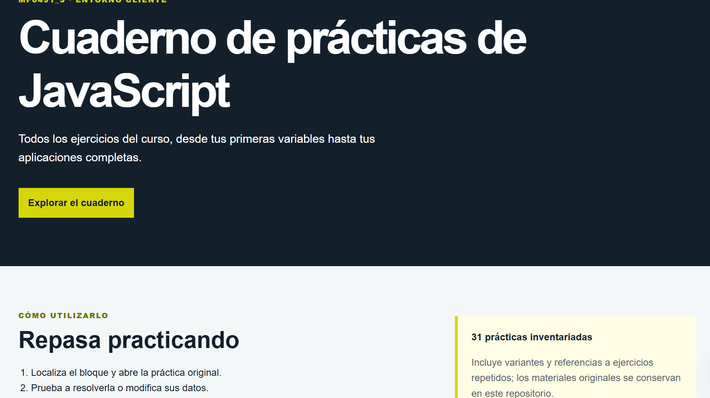
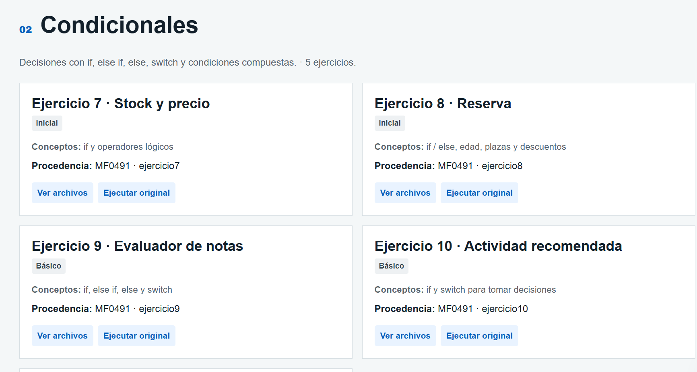

# Cuaderno de prácticas de JavaScript

**MF0491_3 · Programación web en el entorno cliente**

Bienvenido al **Cuaderno de prácticas de JavaScript**, un recopilatorio de los ejercicios realizados durante el curso, organizado para que puedas repasar los conceptos aprendidos y seguir practicando de forma autónoma.

Desde tus primeras variables hasta el desarrollo de aplicaciones completas, encontrarás ejemplos, ejercicios y proyectos con los que reforzar tus conocimientos de HTML, CSS y JavaScript.

## ¿Qué encontrarás en este cuaderno?

- **31 prácticas** organizadas en **7 bloques de aprendizaje**.
- Ejercicios ordenados de menor a mayor dificultad.
- Acceso a las aplicaciones y ejercicios originales.
- Archivos HTML, CSS y JavaScript para consultar y copiar.
- Código para repasar y comprender los conceptos trabajados.
- Archivos ZIP descargables para practicar en Visual Studio Code.

## Índice de contenidos

El cuaderno está organizado en siete bloques que recogen los principales contenidos trabajados durante el curso.

| Bloque | Contenidos |
|---|---|
| 1. Fundamentos y operadores | Variables, tipos de datos y operadores |
| 2. Condicionales | Comparaciones y toma de decisiones |
| 3. Bucles | Repeticiones y recorridos |
| 4. Funciones e interacción | Funciones, parámetros, botones y eventos |
| 5. Arrays y objetos | Colecciones de datos y métodos |
| 6. DOM y persistencia | Manipulación del HTML, localStorage y JSON |
| 7. Proyectos integradores | Aplicaciones que combinan los conocimientos aprendidos |

## Inventario de ejercicios

Cada práctica dispone de su propia tarjeta, desde la que puedes acceder al ejercicio y consultar sus archivos.

La opción **Ver archivos** permite revisar el código HTML, CSS y JavaScript disponible, copiarlo y descargar la carpeta del ejercicio en formato ZIP.

## ¿Cómo utilizar el cuaderno?

1. **Selecciona un bloque:** comienza por los fundamentos o accede directamente al concepto que necesites repasar.
2. **Elige un ejercicio:** lee su enunciado e intenta resolverlo antes de consultar el código.
3. **Consulta los archivos:** utiliza la opción «Ver archivos» para revisar cómo está desarrollado.
4. **Descarga la práctica:** guarda el ZIP, descomprímelo y abre la carpeta en Visual Studio Code.
5. **Experimenta:** modifica variables, cambia condiciones, añade elementos o prueba nuevas funcionalidades.

## De los primeros ejercicios a los proyectos completos

A lo largo del curso hemos avanzado desde instrucciones sencillas hasta aplicaciones capaces de gestionar información e interactuar con el usuario.

Hemos trabajado con variables, condicionales, bucles, funciones, arrays, objetos, eventos, manipulación del DOM y almacenamiento de datos mediante localStorage.

Los últimos proyectos, como **TecnoAula, la agenda de tareas, el gestor de alumnos y el gestor de citas**, nos permiten comprobar cómo los mismos conocimientos pueden aplicarse a situaciones diferentes.

## Organización de los archivos

El cuaderno conserva los materiales utilizados durante el curso.

- `materiales/js-clases-avante/`: ejercicios y recursos de una de las colecciones originales.
- `materiales/javascript/`: ejercicios, proyectos y variantes de la segunda colección.
- `descargas/`: archivos ZIP de las 31 prácticas.
- `images/`: imágenes utilizadas en la presentación del cuaderno.

Se han conservado los materiales originales para poder consultar las distintas versiones de los ejercicios.

Algunas prácticas incluyen soluciones completas, mientras que otras conservan las plantillas utilizadas en clase para que puedas resolverlas por tu cuenta.

## Sigue aprendiendo

No necesitas memorizar todo el código. Lo importante es comprender qué hace cada instrucción, cómo se relacionan las funciones y cómo utilizar los conocimientos adquiridos para resolver nuevos problemas.

**Consulta, modifica, experimenta y vuelve a intentarlo. La programación se aprende programando.**

---

**Inma Contreras**  
*Docente y desarrolladora web*

**DevCampus · Aprender haciendo**"# cuaderno-de-ejercicios" 
